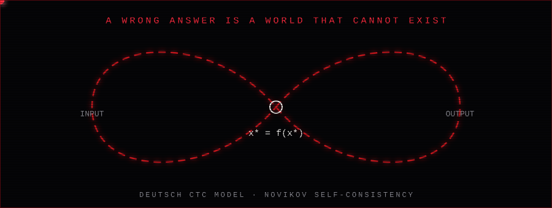
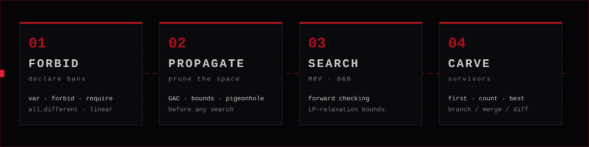

<div align="center">


</div>

**NIHIL** is a constraint engine and the idea behind it.

You don't write an algorithm. You state what **cannot** be. Propagation destroys the impossible, search carves what remains, and the survivors are the answer. One Python file, no dependencies.

## ⚙ Engine

```python
from nihil import World

w = World("triples").vars("xyz", range(1, 30))
w.require(("x", "y", "z"), lambda x, y, z: x*x + y*y == z*z)
w.forbid(("x", "y"), lambda x, y: x >= y)

w.first()    # {'x': 3, 'y': 4, 'z': 5}
w.count()    # every surviving world
```

| Capability | What it does |
|---|---|
| **GAC propagation** | generalized arc consistency on constraints of any arity |
| **`all_different`** | singleton elimination, pigeonhole failure, hidden singles |
| **`linear`** | `Σ cᵢxᵢ  ≤ / ≥ / ==  rhs` with bounds propagation |
| **Search** | MRV + degree ordering, forward checking, lazy generator of all worlds |
| **`optimize`** | branch & bound on linear objectives, Dantzig LP-relaxation bounds, critical-variable branching |
| **Chronograph** | `branch()`, `merge()` (intersect realities), `diff()` (compare them) |
| **Forbid language** | write problems in `.nihil` text files, run them from the CLI |

### Measured



Pure Python, sandbox run, best of 3. Reproduce with `python nihil.py --bench`.
The optimiser is checked against exact dynamic programming in the test suite.

## ⌖ The Forbid language

```
world knapsack
var a b c d e in 0..1
require 12*a + 7*b + 11*c + 8*d + 9*e <= 26
maximize 24*a + 13*b + 23*c + 15*d + 16*e
```

```bash
python nihil.py run knapsack.nihil
# optimum = 51   {'a': 0, 'b': 1, 'c': 1, 'd': 1, 'e': 0}
```

Statements: `world` · `var … in lo..hi` · `all_different` · `require` · `forbid` · `maximize` / `minimize` · `solve first|count|all`.
Expressions are parsed with a restricted AST (no attribute access, no arbitrary calls). Integer linear `require` lines are compiled into the fast global constraint automatically.

## ⚛ The idea

<div align="center"></div>

In Deutsch's model of closed timelike curves with Novikov self-consistency, a loop returns its output to its own input. Only a **fixed point** `x* = f(x*)` can exist, so a wrong answer is not an error: it is a world that cannot happen. In that theoretical model (Aaronson–Watrous), such a computer solves all of **PSPACE**.

`nihil.py` is the classical shadow of this: same interface (forbid worlds, keep survivors), ordinary hardware, real limits. `fixpoint.py` emulates the Deutsch consistency condition.

<div align="center"></div>

## ☠ Limits

- CTCs have **not** been observed. The PSPACE statement belongs to the theoretical model, not to any existing machine.
- `nihil.py` runs on silicon. NP-hard problems remain exponential in the worst case; propagation and bounds just remove a great deal of the space.
- The optimiser handles **linear** objectives. Non-linear scoring goes through `best()`, which is exhaustive.
- Only run `.nihil` files you trust.

## ▣ Run

```bash
python nihil.py --test    # self-tests
python nihil.py           # demos
python nihil.py --bench   # timings
python nihil.py run knapsack.nihil
python fixpoint.py         # Deutsch fixed-point emulation
```

## ▤ Roadmap

- [x] GAC engine, global `all_different` and `linear`
- [x] Branch & bound optimiser with LP bounds
- [x] Branch / merge / diff of worlds
- [x] Forbid language and CLI
- [ ] Table, cumulative and element constraints
- [ ] Restarts and nogood learning
- [ ] Non-linear objectives
- [ ] PyPI release

MIT · see [LICENSE](LICENSE)
