<div align="center">



</div>

## ⚙ What we build

Engines that turn rules into answers. You state what **cannot** be; the machine removes the impossible and keeps what survives.

| Project | What it is | Status |
|---|---|---|
| [**NIHIL**](https://github.com/vantacorehq/nihil) | Zero-dependency constraint engine in pure Python: GAC propagation, global `all_different` / `linear`, branch & bound optimisation, branch / merge / diff of solution spaces, and a small language for writing problems | working, tested |

## ▣ Try it

```bash
git clone https://github.com/vantacorehq/nihil
cd nihil
python nihil.py --test
python nihil.py --bench
```

## ☠ Principles

- Real code first. Every claim is backed by a test or a benchmark you can run.
- Limits are written down next to the features.
- No dependencies unless they earn their place.
